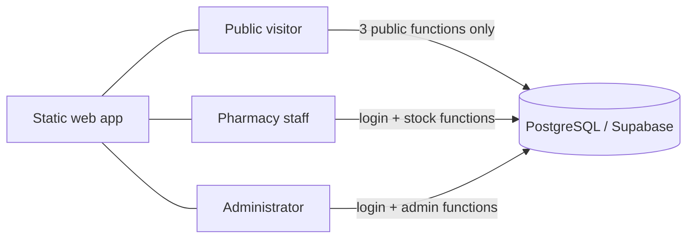

# pharmastock1
# PharmaStock

**Find medicines faster. Keep pharmacy stock accurate.**

PharmaStock is a mobile-first web platform for pharmacies in Lomé, Togo. It has two connected parts:

- **PharmaStock Find:** a public search where people look up a medicine (by name, brand, strength or form) and see which participating pharmacies report it in stock, how fresh that information is, and how to call or reach them.
- **PharmaStock Pro:** a private inventory system for pharmacies to track batches, expiry dates, suppliers and every stock movement, and to decide what appears publicly.

The interface is in French, prices are in CFA francs, and the design targets Android phones.

> **Project status: early and untested.** The database and the app were written but have **not yet been run end to end**. All sample data is fictional. This is not ready for real pharmacies or real patients' decisions. See [Status and limitations](#status-and-limitations).

## Why

When a medicine is out of stock, people travel from pharmacy to pharmacy to find it. Pharmacies, for their part, often track stock on paper or in spreadsheets. PharmaStock connects the two sides, and its main design rule is: **never present uncertain information as confirmed.**

## How availability is decided

For one exact medicine (a specific strength and dosage form), each listed pharmacy shows one of three statuses:

| Status | Meaning |
|---|---|
| **DISPONIBLE** | Recently verified information, and at least one non-expired batch in stock |
| **CONFIRMER LA DISPONIBILITÉ** | The pharmacy's information is older than its limit (48 hours by default), so the visitor is told to call first |
| **INDISPONIBLE** | Recently verified information, and no eligible stock |

Rules built into the database:

- Expired batches never count as available stock. Expiry is checked when someone searches, so no scheduled job is needed.
- Different strengths and dosage forms are never merged into one product.
- Exact quantities are never public unless a pharmacy turns that on for a product.
- Only verified pharmacies can publish, and a manager chooses which products are public.
- Purchase costs, suppliers, staff and internal reports are never exposed publicly.

## Features

**Public (no account)**
- Search by generic name, brand, strength or form, then confirm the exact variant before seeing results
- Filter by neighborhood; call and directions buttons; last verification time; pharmacy directory

**Pharmacies**
- Registration with administrative verification and acceptance of the terms and privacy policy
- Batch and expiry tracking, with multiple batches per product
- Receipts, sales, breakage, returns, expiry write-offs and adjustments, each recorded in an append-only ledger with staff member and reason
- Minimum stock thresholds, alerts (low stock, out of stock, expiring, expired, unusual adjustments)
- Confirm "my stock is up to date", choose what is public, set public prices, export the inventory as CSV

**Administrators**
- Verify or suspend pharmacies and approve new medicines for the public catalogue
- Administrators cannot see any pharmacy's private inventory

## Architecture



The app is a single static page. **All rules live in the database**, not in the page: row-level security limits each pharmacy to its own data, and stock changes go through functions that lock the batch, validate the change, and write the balance and the ledger together. Hiding a button in the app grants nothing.

## Repository layout

```
pharmastock-db/    PostgreSQL / Supabase: schema, stock engine, security rules,
                   fictional demo data, SQL tests, concurrency test
pharmastock-app/   French static web front end (no build step)
```

## Quick start

1. **Database:** follow [`pharmastock-db/README.md`](pharmastock-db/README.md). In short: install the Supabase CLI, run `supabase start`, then `supabase db reset` to apply the migrations and the demo data, then run the tests in `tests/`.
2. **App:** follow [`pharmastock-app/README.md`](pharmastock-app/README.md). Put your Supabase URL and public anon key in `config.js`, then serve the folder, for example with `python3 -m http.server 8080`.

## Tech

PostgreSQL (via Supabase: Auth and row-level security), plain HTML/CSS/JavaScript, and `supabase-js`. No framework and no build step.

## Status and limitations

- **Not yet run end to end.** Run the migrations, tests and app, and fix what breaks, before anything else.
- **Demo data only.** The sample pharmacies, phone numbers and stock are invented and labeled `[DÉMO]`.
- **Not built yet:** supplier screens, staff invitations and user management, map and GPS search, a settings screen for alert thresholds, reports beyond the inventory CSV.
- **Needs hardening before launch:** rate limiting on public functions, CAPTCHA and e-mail confirmation on registration, backups and monitoring, and an independent security review of the database functions.
- **Legal and regulatory:** the project stores *that* terms were accepted, but it does not include the terms or privacy policy. Those, and compliance with Togolese rules on personal data and on pharmacies and medicines, need review by a qualified local professional. A real process to verify pharmacy authorizations is also required.
- **No patient data.** There are no patient records or prescriptions in this version, and the schema has nowhere to put them.

## Roadmap

1. Get the database and tests passing; fix issues found
2. Connect the app to a hosted Supabase project and test with the demo pharmacies
3. Supplier management and staff invitations
4. Alert settings, richer reports, map and distance search
5. Security review, legal documents, and a pilot with a small number of real pharmacies

## Contributing

Issues and suggestions are welcome. Please do not include real pharmacy or patient data in issues or pull requests.

## License

No license has been chosen yet. Until one is added, all rights are reserved by the author. Add a `LICENSE` file when you decide how others may use the code.

